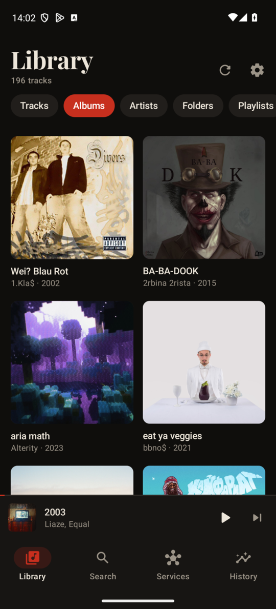
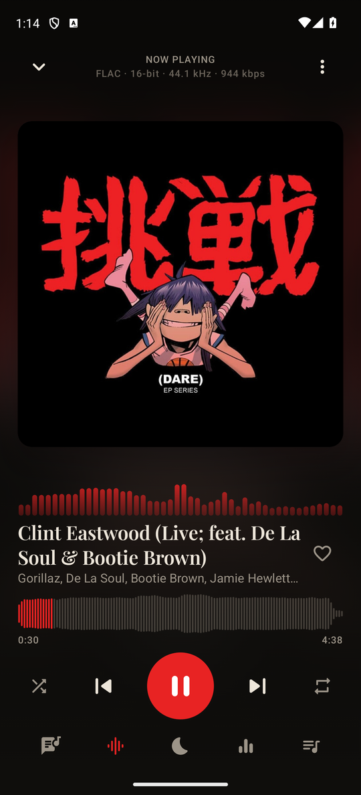
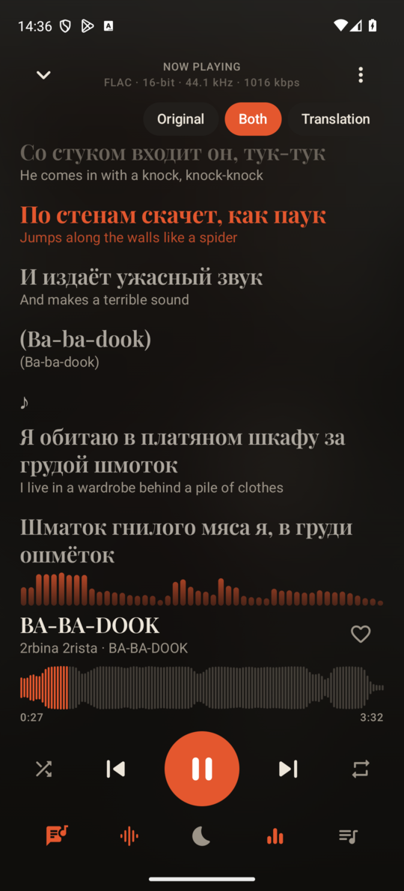
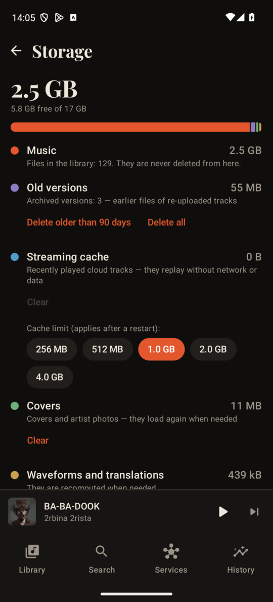
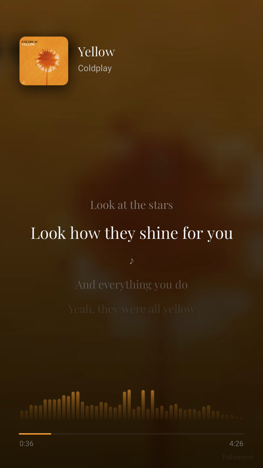
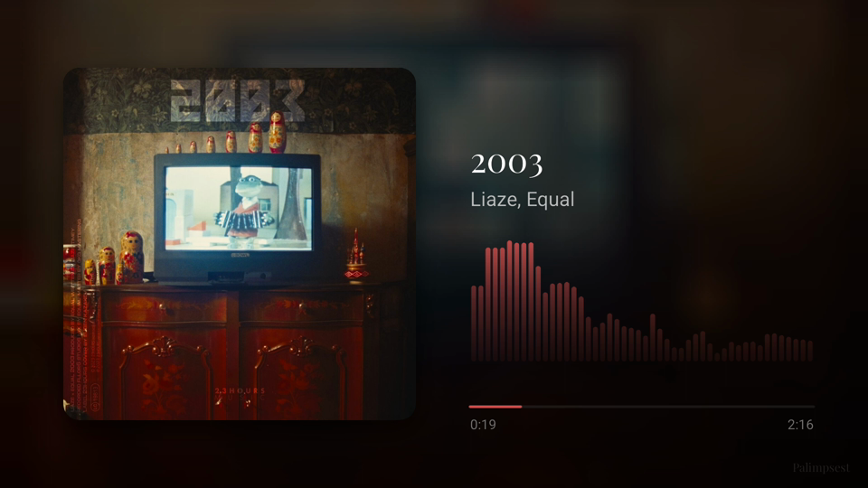

# Palimpsest

**English** | [Русский](README.ru.md)

> ⚠️ **Beta.** Palimpsest is pre-1.0 — expect a few rough edges. Please report bugs and ideas in the
> [issues](https://github.com/xvin84/palimpsest/issues); the in-app error log has a «Copy details» button for that.

A music player for Android where nothing gets erased. When an artist re-uploads a track, the old version
stays in its history — like the earlier text on a palimpsest. Local files first, streaming services second:
your library plays offline, Yandex Music and YouTube Music fill the gaps, and every download lands in your
music folder as a properly tagged file.

<p>
  
  
  
  
</p>

## Features

**Library, offline first**
- Scans `Music/` (and any folders you add) incrementally: about half a second per hundred new FLACs, milliseconds on rescans.
- Tracks, albums, individual artists (features are split out), folders, playlists, favourites; filters by source, sorting.
- Understands Murglar's layout (`Murglar/Яндекс/Artist - Title.flac`), album folders, yt-dlp files with `[videoId]`;
  a `URL` tag links a file to its Yandex track. Picks up `.m3u/.m3u8` playlists, even ones written on a PC.
- «Open with» from any file manager or messenger.
- Duplicate finder: copies merge into one track and the extra files become its versions.
- Missing covers are found (Yandex, MusicBrainz / Cover Art Archive) and embedded into the files.
- **Storage screen**: what the app keeps (music, old versions, streaming cache, covers, backups) and how to free it.
- Files can be deleted and moved; deleted ones wait in a trash and come back with their likes and history.
- Search by kind — tracks, artists, albums, playlists — with a best-match card, sorting and filters.

**Track versions**
- A re-uploaded track downloads next to the old one; the old file moves to `Music/.palimpsest/versions/`, hidden from other players.
- Any version can be played, restored or deleted; **A/B comparison** switches between versions at the same second.
- «Replace with FLAC» re-downloads lossy files in lossless, keeping the old ones as versions.
- The same audio is never stored twice (an audio fingerprint, so editing tags doesn't count as a new version).

**Player**
- Background playback, lock screen, Bluetooth buttons, gapless, smooth transitions between tracks, Android Auto.
- 10-band equalizer with presets, your own profiles and **AutoEQ** import; a separate profile for each pair of headphones.
- ReplayGain, a limiter against clipping, speed and pitch (slowed / nightcore), sleep timer with a fade-out.
- Spectrum visualiser (bars, mirror, ring around the cover) without the microphone permission.
- Synced lyrics from the file tag, a `.lrc`, Yandex, **LRCLIB**, **NetEase** or **Genius**; tap a line to seek;
  a translation into the app's language — under each line or instead of it. Found lyrics go straight into the file's tag.
- Seek on the track's waveform; the colours follow the cover.

**Services**
- **Yandex Music**: sign-in with a device code, likes, playlists, search, lossless streaming, downloads with tags,
  covers and synced lyrics; liked tracks download right away. **My Wave** (with mood/character/language tuning and
  activity stations), radio by track or artist, artist pages, albums, similar tracks, new release notifications.
- **YouTube Music**: no account needed — search, streaming, downloads (M4A with tags).
- **Bandcamp**: search, artists, albums, streaming and downloads.
- **Spotify**: playlists and albums are imported by link and matched on Yandex or YouTube.
- The proxy setting applies only to YouTube, Spotify, Bandcamp and the cover databases; everything else goes direct.
- Offline wave: a mix of your downloads when there's no network.

**Make a video from a track**
- The whole track rendered to MP4: the audio straight from the file through your EQ (no microphone, no noise),
  the visualiser and either the cover or the synced lyrics scrolling along. 9:16 for Reels/Shorts or 16:9 for YouTube.

<p>
  
  
</p>

**And also**
- History, most played, Wrapped-style yearly stories, a «now listening» share card (or the file itself), ListenBrainz scrobbling.
- Errors explained in plain words with what to try next, and a journal with copyable details.
- Backups of the library, history, playlists, versions and settings (never sign-in tokens); weekly and one-tap restore.
- Styles **Palimpsest** and **Lane** (full-bleed cover, backgrounds in its colour), switched with one tap.
- Themes: dark, AMOLED black, light, or follow the system. English and Russian.
- Settings by category, with search and an explanation for each option.
- Updates itself from GitHub Releases.

## Install

Download `palimpsest-<version>.apk` from [Releases](https://github.com/xvin84/palimpsest/releases) and open it on the phone
(Android 13 or newer). On the first launch allow «All files access» — it's needed for tags, `.lrc` files and versions;
without it the app can only play.

New versions show up in Settings → Updates and install over the current one.

**If the phone refuses to install it:**
- *«Blocked by Play Protect» / «unsafe app»*: tap «More details» → «Install anyway». Builds before 0.4.1 were signed
  with a development certificate that Play Protect distrusts; later ones use a proper key (and still update the old ones).
- *Samsung «Auto Blocker»*: Settings → Security and privacy → Auto Blocker → off (you can turn it back on afterwards).
- *Xiaomi / HyperOS*: allow installing from the file manager or browser you opened the APK in.
- *«App not installed» on Android 12 or older*: Palimpsest needs Android 13 or newer.

## Build

Requirements: JDK 17, Android SDK (compileSdk 37).

```bash
./gradlew :core:test                    # unit tests of the shared core (DSP, LRC, M3U, Yandex on mocks, lyrics parsers…)
./gradlew :app:assembleDebug            # debug APK
./gradlew :app:assembleRelease          # minified APK; signed with your key if ~/.gradle/gradle.properties has
                                        # palimpsest.keystore / .keystore.password / .key.alias / .key.password,
                                        # otherwise with the debug key
LIVE=1 ./gradlew :core:test --tests '*LiveTest*'   # hits the real services (YouTube, LRCLIB, NetEase, Genius…)
./gradlew :desktop:run                  # desktop preview (Linux): library from ~/Music on the same core
```

## How it's built

```
core/     plain Kotlin/JVM, shared by Android and desktop
  dsp/       equalizer (RBJ biquads), limiter, FFT spectrum, AutoEQ parser
  yandex/    Yandex Music API client, device-code OAuth
  youtube/   NewPipe Extractor
  lyrics/    LRC, LRCLIB, NetEase, Genius
  library/   file names, M3U, versions (fingerprints), artist splitting
app/
  data/      Room, scanner, tags (jaudiotagger), downloads, sync, versions, backups, storage, updates
  playback/  Media3 service, an AudioProcessor for EQ + ReplayGain + spectrum, streaming with cache and decryption
  render/    track → video (Media3 Transformer, frames drawn on Canvas)
  ui/        Compose screens
desktop/  Compose Multiplatform preview
```

Kotlin · Jetpack Compose · Media3 (ExoPlayer, Transformer) · Room · jaudiotagger · NewPipe Extractor

Fonts: Playfair Display and Manrope, both under the SIL Open Font License.

## License

[GPL-3.0](LICENSE). Palimpsest is free software: use it, study it, change it and share it under the same terms.

Palimpsest isn't affiliated with Yandex, Google or Spotify. Streaming services are used through their public and
unofficial interfaces for your personal listening with your own account; please respect their terms.
