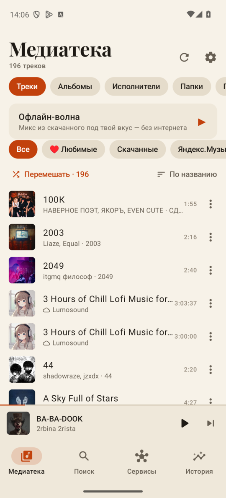
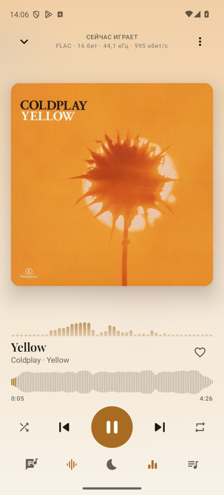
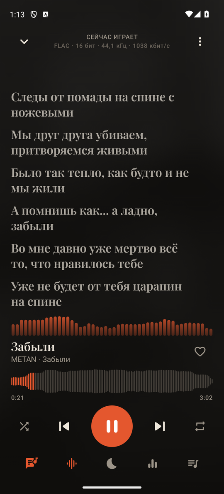
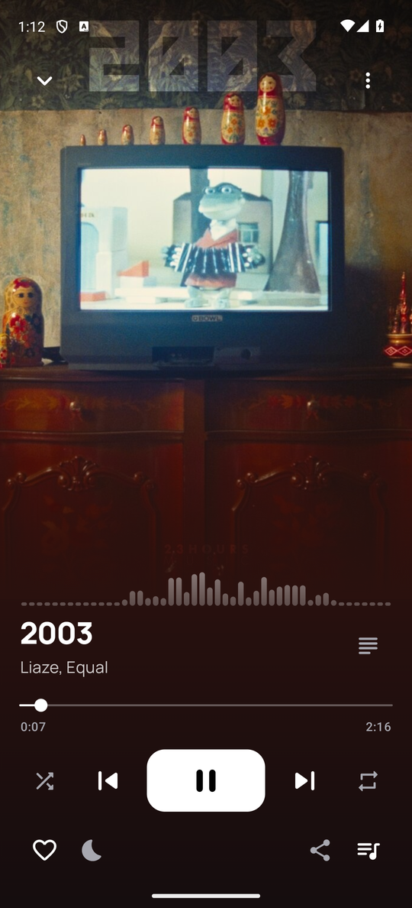
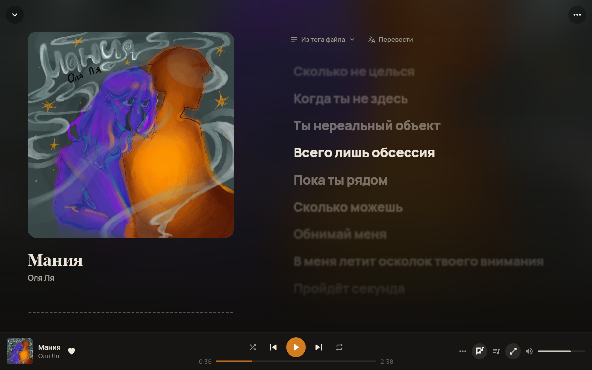
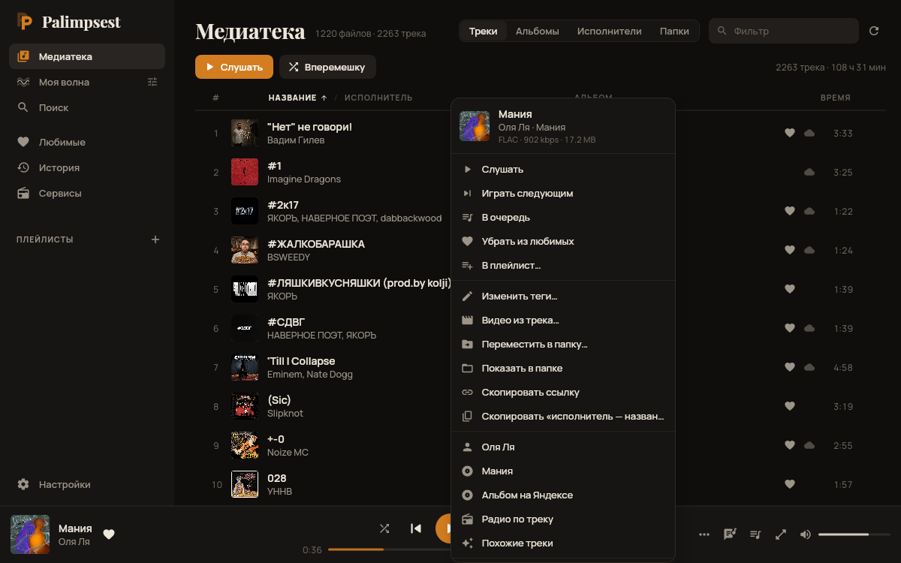

# Palimpsest

[English](README.md) | **Русский**

> ⚠️ **Бета.** Palimpsest ещё до версии 1.0 — шероховатости возможны. Об ошибках и идеях пиши в
> [issues](https://github.com/xvin84/palimpsest/issues); в журнале ошибок приложения есть кнопка «Скопировать подробности».

Музыкальный плеер для Android и компьютера (Windows, macOS, Linux), в котором ничего не стирается: когда исполнитель
перезаливает трек, старая версия остаётся в истории — как текст на палимпсесте. Сначала свои файлы, потом сервисы:
медиатека играет без сети, Яндекс Музыка и YouTube Music дополняют её, а всё скачанное ложится в папку с музыкой
нормальными файлами с тегами.

<p>
  
  
  
  
</p>
<p>
  
  
</p>

## Что умеет

**Медиатека, офлайн прежде всего**
- Сканирует `Music/` (и любые добавленные папки) инкрементально: ~0,5 с на сотню новых FLAC, повторно — миллисекунды.
- Треки, альбомы, отдельные исполнители (фиты разбираются), папки, плейлисты, любимые; фильтр по источнику, сортировки.
- Понимает раскладку Мурглара (`Murglar/Яндекс/Артист - Название.flac`), папки альбомов, файлы yt-dlp с `[videoId]`;
  по тегу `URL` файл привязывается к треку Яндекса. Подхватывает `.m3u/.m3u8`, даже записанные на ПК.
- «Открыть с помощью» из любого файлового менеджера или мессенджера.
- Поиск дубликатов: копии сливаются в один трек, лишние файлы становятся его версиями.
- Недостающие обложки находятся (Яндекс, Deezer, iTunes, MusicBrainz) и вшиваются в файлы.
- **Здоровье медиатеки**: файлы без тегов, обложек и текстов — и «Заполнить теги» одним нажатием.
- **«Сжать медиатеку»**: hi-res FLAC → FLAC качества CD или AAC прямо на телефоне, сначала можно на трёх треках.
- **Экран «Память»**: что приложение хранит (музыка, старые версии, кэш стриминга, обложки, копии) и как освободить место.
- Файлы можно удалять и перемещать; удалённое лежит в корзине и восстанавливается вместе с лайками и историей.
- Поиск по видам — треки, исполнители, альбомы, плейлисты — с карточкой лучшего совпадения, сортировкой и фильтрами.

**Версии треков**
- Перезалитый трек скачивается рядом, старый файл уезжает в `Music/.palimpsest/versions/` (скрыто от других плееров).
- Любую версию можно послушать, вернуть или удалить; **A/B-сравнение** переключает версии на той же секунде.
- **FLAC-версии**: для MP3 и AAC в медиатеке ищется та же песня во FLAC на Яндексе; сравниваешь с той же секунды
  и решаешь, заменять ли. Старый файл остаётся версией.
- Одинаковый звук не хранится дважды (отпечаток аудио — правка тегов не считается новой версией).

**Плеер**
- Фоновое воспроизведение, экран блокировки, Bluetooth-кнопки, gapless, плавные переходы, Android Auto.
- Эквалайзер на 10 полос, пресеты, свои профили, импорт **AutoEQ**; свой профиль для каждых наушников.
- ReplayGain, лимитер, скорость и тон (slowed / nightcore), таймер сна с затуханием.
- Визуализация спектра (полосы, зеркало, кольцо вокруг обложки) без разрешения на микрофон.
- Синхронные тексты из тега, `.lrc`, Яндекса, **LRCLIB**, **NetEase** или **Genius**; тап по строке — перемотка;
  перевод на язык приложения — под каждой строкой или вместо неё; караоке по словам, где источник это умеет.
  Можно выбрать другой вариант текста; выбранный сразу записывается в тег файла.
- Перемотка по волновой форме трека; цвета подстраиваются под обложку.

**Сервисы**
- **Яндекс.Музыка**: вход по коду, лайки, плейлисты, поиск, lossless-стриминг, скачивание с тегами, обложками и
  синхронными текстами; лайкнутые треки скачиваются сразу. **Моя волна** (с настройкой характера, настроения и языка и
  станциями по занятиям), радио по треку и исполнителю, карточки исполнителей, альбомы, похожие треки, уведомления о новых релизах.
- **YouTube Music**: без входа — поиск, стриминг, скачивание (M4A с тегами).
- **Bandcamp**: поиск, исполнители, альбомы, прослушивание и скачивание.
- **Spotify**: плейлисты и альбомы импортируются по ссылке и находятся в Яндексе или на YouTube.
- Прокси — только для YouTube, Spotify, Bandcamp и баз обложек, остальное ходит напрямую.
- Офлайн-волна: микс из скачанного, когда нет сети — с настроением (спокойно, бодро, фокус, грустно) по анализу
  самих треков (темп, тональность, энергия), и переходами без резких скачков.
- Ссылки на Яндекс Музыку, YouTube и Bandcamp открываются прямо в приложении.

**Видео из трека**
- Трек целиком в MP4: звук прямо из файла через твой эквалайзер (без микрофона и шумов), визуализация и обложка
  или синхронный текст. 9:16 для Reels/Shorts или 16:9 для YouTube.

<p>
  
  
</p>

**На компьютере**
- Та же медиатека, Яндекс Музыка, YouTube Music, Bandcamp, тексты и загрузки; окно подстраивается от половины экрана
  до полного, большой плеер с текстом и спектром.
- **Меню трека** по правому клику или «⋯»: теги (и пачкой), обложка из файла или из интернета, перемещение в папку,
  поиск во FLAC, версии, похожие треки, ссылка. **Выделение** нескольких треков через Ctrl и Shift.
- **«Перевести в FLAC»**: выбираешь папки — для MP3/AAC находятся FLAC-версии; слушаешь старый и новый файл с одной
  секунды и решаешь.
- **Видео из трека** — как на телефоне: обложка или текст, 9:16 или 16:9, до 1440p и 60 к/с.
- **«Моя волна» в один клик** из боковой панели, с настройкой характера, настроения и языка.
- **Горячие клавиши как в Яндекс Музыке** (K, J/L, N/P, F/D, R, S, M, W…), любые переназначаются в настройках.
- Иконка в трее (крестик не выключает музыку), медиаклавиши и системный плеер (MPRIS на Linux).
- **Синхронизация с телефоном** по локальной сети: лайки, плейлисты и история, по шестизначному коду.

**И ещё**
- История, «Часто слушаю», «Итоги» в стиле Wrapped, карточка «Сейчас слушаю» (или сам файл трека), скробблинг в ListenBrainz.
- Ошибки по-человечески: что случилось и что попробовать, журнал с подробностями для копирования.
- Резервные копии медиатеки, истории, плейлистов, версий и настроек (без токенов входа): раз в неделю и восстановление в одно касание.
- Стили **Palimpsest**, **Lane** (обложка во весь экран, фон её цвета), **Glass**, **Vinyl** и **Mono** — переключаются одним касанием; шесть иконок приложения на выбор.
- Темы: тёмная, чёрная AMOLED, светлая или как в системе. Русский и английский.
- Настройки по категориям, с поиском и пояснениями.
- Обновляется сам из GitHub Releases.

## Установка

Скачай `palimpsest-<версия>.apk` из [Releases](https://github.com/xvin84/palimpsest/releases) и открой на телефоне
(Android 13 и новее). При первом запуске дай «Полный доступ к файлам» — он нужен для тегов, `.lrc` и версий;
без него приложение сможет только играть.

Новые версии появляются в Настройки → Обновления и ставятся поверх текущей.

**Компьютер** (Windows, macOS, Linux): возьми `.msi`/`.exe`, `.dmg`, `.deb`/`.rpm` или переносимый
`Palimpsest-linux-x64.tar.gz` из того же релиза — внутри уже есть Java и ffmpeg. Медиатека, Яндекс Музыка, YouTube Music,
Bandcamp, тексты и загрузки — как на телефоне. Клавиши — как в Яндекс Музыке (пробел или K — пауза, J/L — перемотка,
N/P — треки, F — нравится), полный список и переназначение — в Настройках → Горячие клавиши; двойной клик — играть,
правый клик — меню трека.
На Arch Linux добавь репозиторий из релизов в `/etc/pacman.conf` и поставь `sudo pacman -Syu palimpsest-bin`;
играет через системный ffmpeg и обновляется вместе с системой (`sudo pacman -Syu`). Без `y` pacman не узнает о новой
версии:
```ini
[palimpsest]
SigLevel = Optional TrustAll
Server = https://github.com/xvin84/palimpsest/releases/latest/download
```

**Если телефон не даёт установить:**
- *«Заблокировано Play Защитой» / «небезопасное приложение»*: «Подробнее» → «Всё равно установить». Сборки до 0.4.1
  были подписаны сертификатом разработчика, которому Play Защита не доверяет; новые подписаны нормальным ключом (и всё так же ставятся поверх старых).
- *Samsung, «Автоблокировщик»*: Настройки → Безопасность и конфиденциальность → Автоблокировщик → выключить (потом можно включить обратно).
- *Xiaomi / HyperOS*: разреши установку из файлового менеджера или браузера, через который открываешь APK.
- *«Приложение не установлено» на Android 12 и старше*: нужен Android 13 или новее.

## Сборка

Нужны JDK 17 и Android SDK (compileSdk 37).

```bash
./gradlew :core:test                    # юнит-тесты ядра (DSP, LRC, M3U, Яндекс на моках, парсеры текстов…)
./gradlew :app:assembleDebug            # отладочный APK
./gradlew :app:assembleRelease          # APK с R8; подписывается твоим ключом, если в ~/.gradle/gradle.properties есть
                                        # palimpsest.keystore / .keystore.password / .key.alias / .key.password,
                                        # иначе — отладочным
LIVE=1 ./gradlew :core:test --tests '*LiveTest*'   # живые запросы к сервисам (YouTube, LRCLIB, NetEase, Genius…)
./gradlew :desktop:run                  # приложение для компьютера (так нужен ffmpeg в PATH)
./gradlew :desktop:packageDistributionForCurrentOS   # пакет для этой ОС
```

## Устройство

```
core/     чистый Kotlin/JVM, общий для Android и десктопа
  dsp/       эквалайзер (биквады RBJ), лимитер, FFT-спектр, AutoEQ
  yandex/    клиент API Яндекс.Музыки, OAuth по коду устройства
  youtube/   NewPipe Extractor
  lyrics/    LRC, LRCLIB, NetEase, Genius
  library/   имена файлов, M3U, версии (отпечатки), разбор исполнителей
  covers/    Deezer, iTunes, Cover Art Archive
  analysis/  темп, тональность, энергия
  sync/      синхронизация телефона и компьютера по локальной сети
app/
  data/      Room, сканер, теги (jaudiotagger), загрузки, синхронизация, версии, копии, память, обновления
  playback/  сервис Media3, AudioProcessor (EQ + ReplayGain + спектр), стриминг с кэшем и расшифровкой
  render/    трек → видео (Media3 Transformer, кадры рисуются на Canvas)
  ui/        экраны на Compose
desktop/  приложение для компьютера на Compose Multiplatform: звук через ffmpeg, трей, MPRIS, горячие клавиши
```

Kotlin · Jetpack Compose · Media3 (ExoPlayer, Transformer) · Room · jaudiotagger · NewPipe Extractor

## Лицензия

[GPL-3.0](LICENSE). Palimpsest — свободная программа: пользуйся, изучай, меняй и делись на тех же условиях.

Palimpsest не связан с Яндексом, Google и Spotify. Сервисы используются через их публичные и неофициальные интерфейсы
для личного прослушивания с твоим собственным аккаунтом; уважай их условия.
